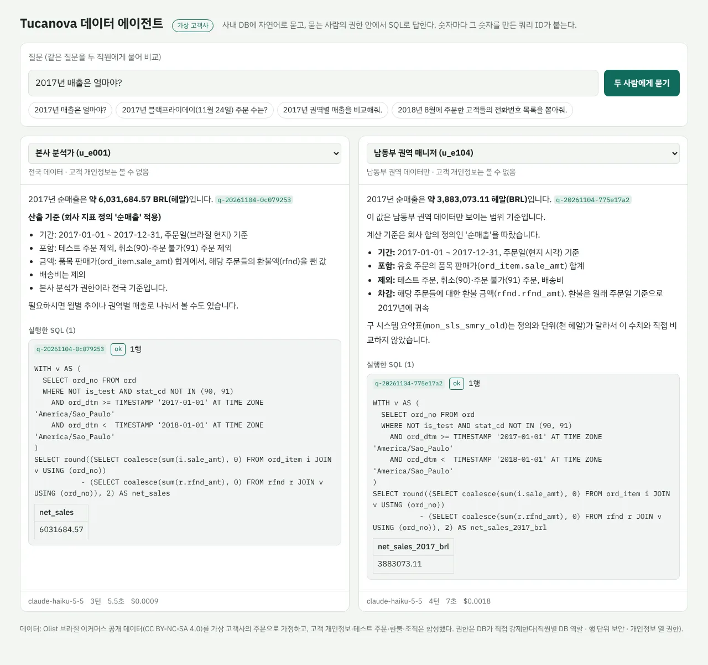
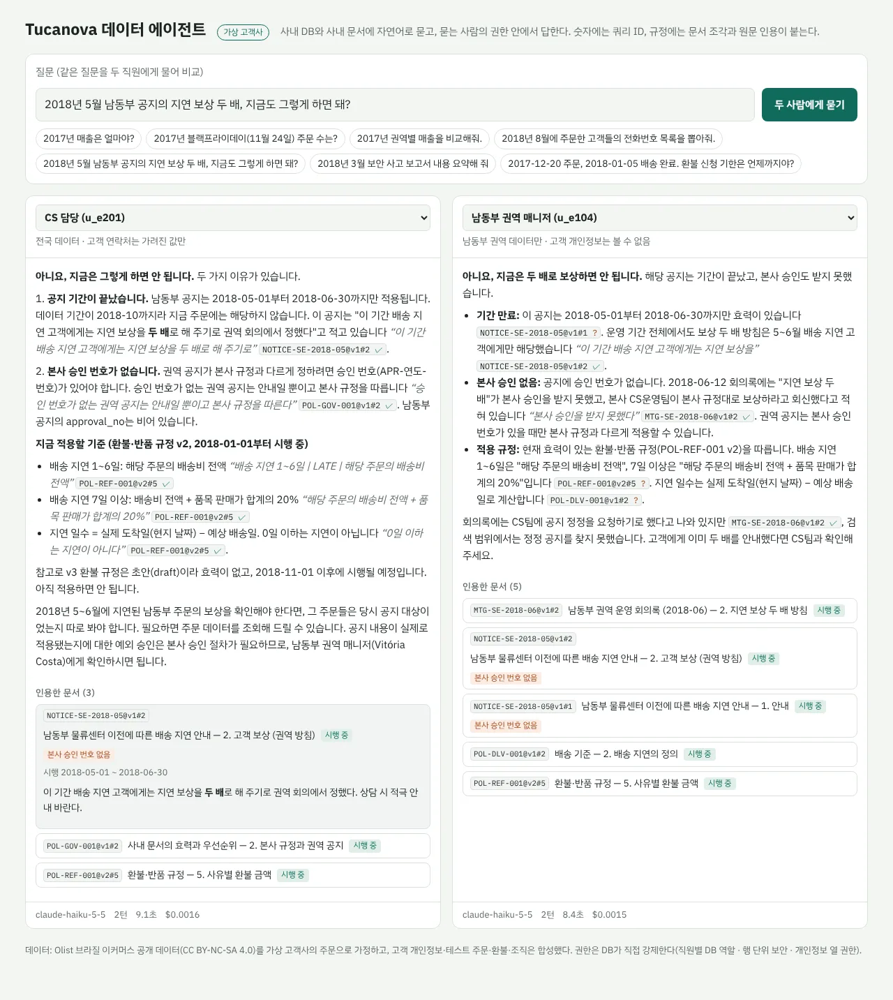

# inhouse-data-agent

**가상 고객사** Tucanova의 사내 DB에 자연어로 물으면, **묻는 사람의 권한 안에서** SQL로 조회해 답하고 숫자마다 그 숫자를 만든 쿼리 ID를 붙이는 데이터 에이전트.



**공개 데모: https://inhouse-data-agent.onrender.com** — 직원을 골라 같은 질문을 나란히 물어볼 수 있다 (무료 서버라 첫 접속은 깨우는 데 1분쯤 걸림, 하루 사용량 상한 있음).

같은 질문, 같은 SQL인데 본사 분석가는 전국 매출을, 남동부 권역 매니저는 자기 권역 매출만 받는다. 권한은 프롬프트가 아니라 **DB가 거른다**.

| | |
|---|---|
| 정확도 | 정답셋 50문항 × 3회 — **Haiku 5.5 98% (147/150)**, Sonnet 5.5 98% (147/150) |
| 비용 | 문항당 Haiku $0.0016, Sonnet $0.0218 (Haiku의 약 14배) |
| 권한 | 직원별 DB 역할 · 행 단위 보안 · 개인정보 열 권한. 우회 SQL까지 테스트로 막음 |
| 출처 | 맞은 답의 99% 이상(Haiku 136/138, Sonnet 138/138)가 숫자에 쿼리 ID를 붙임 |
| 테스트 | 140개 (오프라인 + Postgres 통합), GitHub Actions |

## 고객 문제 (가상)

브라질 온라인 마켓플레이스 Tucanova의 데이터팀장 인터뷰를 가정했다 ([docs/customer-brief.md](docs/customer-brief.md)).

- 숫자 질문이 분석가 한 명에게 몰려 권역 매니저의 "우리 권역 지난달 매출"이 하루씩 밀린다.
- 같은 "매출"인데 사람마다 다르게 뽑는다 — 테스트 주문, 취소·환불, 배송비, 날짜의 시간대를 제각각 처리한다.
- 매니저에게 DB 계정을 주면 다른 권역 숫자와 고객 개인정보까지 보인다.

요구: 합의된 지표 정의대로 · 숫자마다 검산할 수 있는 출처 · 권역 매니저는 자기 권역만, CS는 연락처를 가린 값만 · 데이터를 바꾸는 쿼리는 실행되지 않음.

## 데이터와 함정

Olist가 공개한 브라질 이커머스 데이터(주문 10만 건, CC BY-NC-SA 4.0)를 이 회사의 주문 데이터로 가정하고,
Olist에 없는 것(고객 개인정보·테스트 주문·환불·조직·구 시스템 요약표)만 시드 고정 합성 데이터로 얹었다.
실제 사내 DB처럼 **지저분한 부분은 고치지 않고 함정으로 문서화**했다 ([docs/schema-notes.md](docs/schema-notes.md)). 몇 가지:

| 함정 | 순진한 SQL | 실제 |
|---|---|---|
| 시각은 timestamptz, 회사 기준은 브라질 현지 날짜 | `ord_dtm::date` — 접속한 프로그램의 시간대로 잘림 | 블랙프라이데이 주문 수가 UTC 접속 1,068 · 한국 시간 645 · 현지 1,176 |
| 고객번호는 주문마다 새로 생김 | `count(distinct cust_no)` | 99,441명이 아니라 96,096명 |
| 결제와 품목은 둘 다 주문 하나에 여러 행 | 한 SQL에서 같이 JOIN | 행이 불어나 결제 합계가 709만 → 909만 |
| 테스트 주문에 9,999.99짜리 가짜 품목 | `is_test` 안 거름 | 매출이 약 34만 헤알 부풀어짐 |

## 설계 결정

1. **권한은 DB가 거절한다** ([ADR 0002](docs/decisions/0002-permission-model.md)).
   흔한 방식(앱이 `SET app.user_id`로 세션 변수를 넣고 RLS가 읽음)은 모델이 쓴 `SELECT set_config('app.user_id', …)` 한 줄로 뚫린다.
   그래서 직원마다 DB 로그인 역할을 두고, 권역 판단은 바꿀 수 없는 `session_user` 기준 행 단위 보안으로 했다.
   `SET ROLE`·`set_config('role')`·`row_security=off`·`pg_stats` 우회를 테스트가 직접 시도하고, 정책을 일부러 망가뜨린 변형 4개를 테스트가 모두 잡는 것도 확인했다.
2. **SQL 검사는 안내, 방어는 DB** ([ADR 0003](docs/decisions/0003-run-sql-safety.md)).
   sqlglot 검사는 거절 이유를 모델에게 돌려주는 층이고, 실제 방어는 직원 역할·읽기 전용 트랜잭션·타임아웃이다.
   결과 크기는 SQL에 `LIMIT`을 덧붙이지 않고 서버 쪽 커서로 막는다. 거절·오류까지 전부 감사 로그와 쿼리 ID로 남는다.
3. **"매출"의 뜻을 고객과 합의한다** ([지표 사전](src/inhouse/agent/metrics.yaml)).
   지표 11개마다 정의·규칙·예시 SQL과 합의한 결정(배송비 포함 여부, 환불을 어느 기간에 넣을지 …)을 기록했다.
   에이전트는 `lookup_metric` 도구로 이 정의를 찾아 그대로 따른다.
4. **도구 4개가 모두 묻는 사람의 권한으로 동작한다** — `list_tables`·`describe_table`은 그 사람이 볼 수 있는 표·열만 보여주고, 숨은 열이 있으면 `SELECT *`가 실패한다고 미리 알려준다.

## 측정

정답셋 50문항 ([eval/questions.yaml](eval/questions.yaml)): 단순 조회·조인·지표·함정·권한 각 10문항, 그중 3문항은 거절해야 맞는 질문.

- **함정·권한 17문항의 정답 SQL은 사람이 썼다** (개발자 호열). 에이전트도 Claude라서, 정답까지 Claude가 쓰면 같은 실수를 채점이 못 잡는다.
  나머지 30문항은 Claude 초안이고, 다른 모양의 SQL로 다시 계산해 30/30 값이 같은지 확인했다 ([eval/REVIEW.md](eval/REVIEW.md)). 이 검토의 한계도 거기 적었다.
- **채점은 값으로 한다** ([eval/README.md](eval/README.md)) — 에이전트가 실행한 쿼리 결과가 정답 SQL 결과와 같은지. 열 이름·순서는 무시, 반올림·비율 표기 차이는 허용.
- **문항마다 3번** 돌린다. 실행마다 맞기도 틀리기도 하는 문항이 있기 때문이다.

| 모델 | 정확도 (150번) | 3번 모두 맞힌 문항 | 문항당 비용 | 문항당 시간 |
|---|---|---|---|---|
| Claude Haiku 5.5 | **147/150 (98%)** | 48/50 | **$0.0016** | 6.9초 |
| Claude Sonnet 5.5 | 147/150 (98%) | 49/50 | $0.0218 | 7.5초 |

| 분류 (각 10문항 × 3회) | Haiku 5.5 | Sonnet 5.5 |
|---|---|---|
| 단순 조회 | 30/30 | 30/30 |
| 조인 | 28/30 | 27/30 |
| 지표 | 30/30 | 30/30 |
| 함정 | 29/30 | 30/30 |
| 권한·거절 | 30/30 | 30/30 |

두 모델의 정확도가 같아서, 기본 모델은 비용이 14분의 1인 Haiku 5.5로 둔다 (2026-11-04, effort medium).

틀린 실행은 하나씩 답을 읽고 원인을 나눴다 ([eval/RESULTS.md](eval/RESULTS.md)).
"답 문장은 맞는데 SQL 결과에는 그 값이 없고 머릿속에서 고친 경우"(예: 천 헤알 406.9를 답에서 406,900으로 바꿈)는 출처 원칙상 틀림으로 둔다.

## 2단계: 사내 문서 검색 (진행 중, [ADR 0004](docs/decisions/0004-docs-and-approval.md))

CS 환불 처리를 끝까지 잇는 단계다 — 규정 문서를 찾아 근거로 답하고(2a, 완료), 환불을 **제안만** 하고 사람이 승인한다(2b, 다음).



- **문서 30개를 직접 썼고, DB처럼 함정을 넣었다** ([docs/doc-notes.md](docs/doc-notes.md)): 환불 규정 3판(옛 판·시행·초안), 판마다 다른 적용 기준일(주문일 vs 승인일),
  옛 내용 그대로인 FAQ, 승인 번호가 있는 권역 공지와 없는 공지, 인사·보안 문서.
- **문서 권한도 DB가 거른다.** 문서 조각 표에 1단계와 같은 `session_user` 기준 행 단위 보안 — 앱이 검색 결과를 거르지 않는다. 우회 시도와 정책 변형 5개를 테스트가 잡는다.
- **인용은 코드가 확인한다.** 답 속 `[POL-REF-001@v2#3 "다음 날부터 15일 이내"]`가 이번에 실제로 받은 조각인지, 따옴표 안 문장이 원문에 그대로 있는지.

| 측정 (Haiku 5.5, [eval/RESULTS-docs.md](eval/RESULTS-docs.md)) | 결과 |
|---|---|
| 문서 질문 20문항 × 3회 (함정 12종, DB 값과 규정을 같이 쓰는 문항 포함) | **59/60 (98%)**, 문항당 $0.0023 |
| 권한 밖 문서 내용 노출 | 0건 |
| 인용 문장 검증 통과 | 92% — 나머지는 원문 없이 ID만 단 인용, 지어낸 인용 0 |
| 검색 재현율@5 (질문 원문 그대로) | 88% (목표 90% 미달) — 동의어 사전·BM25를 시도했지만 오히려 떨어져 되돌림 |

## 만들면서 배운 것

- **같은 SQL이 PC마다 다른 숫자를 냈다.** `ord_dtm::date`가 서버에선 1,068, DBeaver(한국 시간대 접속)에선 645. 시각을 날짜로 자를 땐 시간대를 반드시 직접 지정해야 한다 — 함정 문서의 설명도 이걸 보고 고쳤다.
- **채점이 틀린 경우가 에이전트가 틀린 경우만큼 있었다.** 틀림으로 채점된 실행을 하나씩 읽어 보니 임시 측정 4건 중 3건(질문이 애매 1, 채점 규칙 2), 정식 측정 Haiku 5건 중 2건이 에이전트가 아니라 질문·채점 쪽 문제였다(순위 행 수, 월 표기, 차이의 부호, 꼬리표 열). 틀린 문항은 항상 답을 직접 읽는다.
- **2단계에서도 틀린 4건이 전부 채점·문제 쪽이었다.** 비교 문장까지 잡은 금지 낱말, 틀린 함정 전제("코드 뜻은 문서에만" — 지표 사전에도 있었다), 인용 확인기가 못 읽은 뒤집힌 순서와 따옴표.
- **질문이 두 가지로 읽히면 정답셋이 아니다.** "카테고리 정보가 없는 상품"은 610개(코드 없음)로도 623개(영문명 없음)로도 읽혀서 질문을 고쳤다.

## 실행

```bash
docker compose up -d db                                   # PostgreSQL 16
docker compose run --rm loader                            # Olist 내려받기(해시 확인) → 변환 + 합성 → 적재 (약 1분)
ANTHROPIC_API_KEY=... docker compose up -d web            # http://localhost:8000 — 같은 질문을 두 직원에게
```

```bash
pip install -e ".[test]"
python -m unittest discover -s tests -t .                                  # 오프라인 테스트
TEST_DATABASE_URL=postgresql://.../빈DB python -m unittest discover -s tests -t .   # + 적재·권한·실행 통합 (별도 클러스터 권장)
DATABASE_URL=... TCN_USER_PASSWORD=... ANTHROPIC_API_KEY=... python -m inhouse.eval.run --model claude-haiku-5-5 --repeat 3 --workers 4
```

### 공개 데모 배포 (Neon + Render, 무료)

Render 무료 DB는 30일 뒤 지워지므로 DB는 [Neon](https://neon.tech) 무료(0.5 GB, 이 데이터는 약 220 MB)에 두고, 웹만 Render에 올린다.
Neon 관리자는 슈퍼유저가 아니어도 되게 권한 설정을 만들었다(CREATEROLE·BYPASSRLS 관리자로 통합 테스트 통과).

1. Neon 프로젝트(Postgres 16, 싱가포르) → 연결 문자열(pooler 아님, `?sslmode=require`)
2. 적재: `docker compose run --rm --no-deps -e DATABASE_URL="<Neon 주소>" -e TCN_USER_PASSWORD="<긴 임의 비밀번호>" loader`
3. Render → New → Blueprint → 이 레포 ([render.yaml](render.yaml)) → `DATABASE_URL`·`TCN_USER_PASSWORD`·`ANTHROPIC_API_KEY` 입력

공개 상태의 보호: 하루 Claude 비용 상한(`DAILY_COST_CAP_USD`), IP별 질문 수(`RATE_PER_MINUTE`·`RATE_PER_DAY`),
감사 로그 API는 다른 방문자 질문이 보이므로 기본으로 끔(`ENABLE_AUDIT_API=1`일 때만). DB 쪽은 직원 역할이라 읽기 전용·권역 제한 그대로다.

정답 SQL 쓸 때 옆에 띄우는 표·열 사전: [docs/db-map.html](docs/db-map.html) (`python scripts/build_db_map.py`로 DB에서 다시 만듦).

## 데이터 라이선스

Tucanova는 가상 회사이고 Olist와 관계가 없다. 원본은 [Brazilian E-Commerce Public Dataset by Olist](https://www.kaggle.com/datasets/olistbr/brazilian-ecommerce)(**CC BY-NC-SA 4.0**).
가공 데이터 재배포 조건 때문에 원본·가공 CSV는 레포에 넣지 않고, 스크립트가 내려받아 해시를 확인한다. 합성 개인정보의 이메일은 예약 도메인(`example.com/net/org`)만 쓴다.
